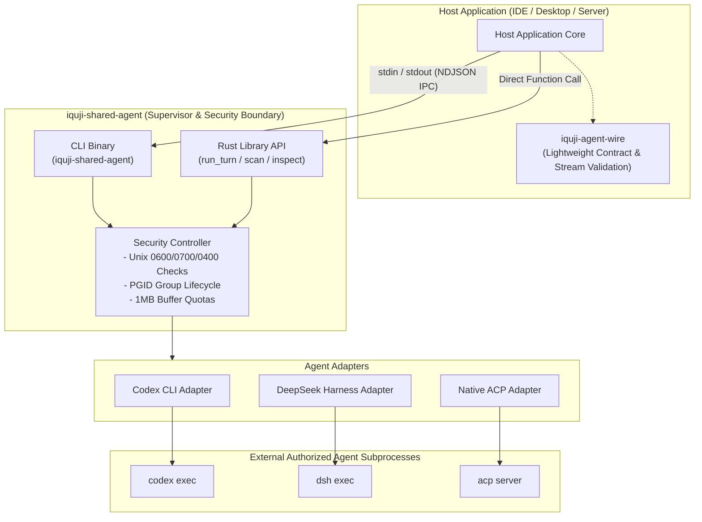
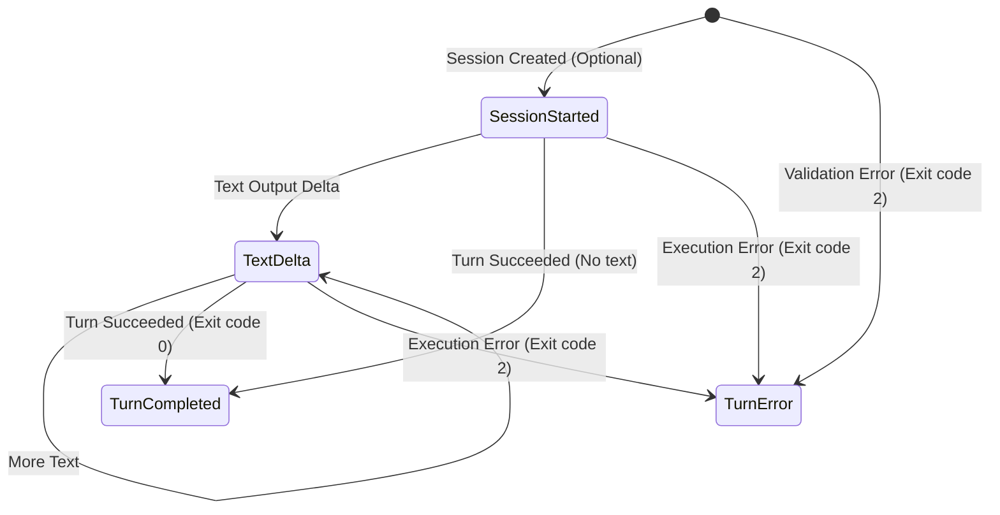

# iquji-agent

<div align="center">

[](https://crates.io/crates/iquji-shared-agent)
[](https://crates.io/crates/iquji-agent-wire)
[](https://github.com/haydardsx/iquji-community-agent/actions/workflows/ci.yml)
[](LICENSE)
[-orange.svg)](rust-toolchain.toml)
[](https://docs.rs/iquji-shared-agent)

**A Zero-Trust Rust Gateway and Sandboxed Process Supervisor for Locally Authorized AI Coding Agents**

[简体中文](README.md) | [English](README.en.md)

</div>

---

## Table of Contents

- [Overview & Problem Statement](#overview--problem-statement)
- [Architecture & Artifacts Overview](#architecture--artifacts-overview)
  - [System Architecture Diagram](#system-architecture-diagram)
  - [Core Artifacts & Consumption Matrix](#core-artifacts--consumption-matrix)
- [Supported Agents & Capability Matrix](#supported-agents--capability-matrix)
- [Security & Sandboxing Architecture](#security--sandboxing-architecture)
- [Quick Start](#quick-start)
- [Comprehensive Usage Guide](#comprehensive-usage-guide)
  - [1. Using the Command-Line Interface (CLI)](#1-using-the-command-line-interface-cli)
  - [2. Integrating as a Rust Library (iquji-shared-agent)](#2-integrating-as-a-rust-library-iquji-shared-agent)
  - [3. Using the Lightweight Wire Contract (iquji-agent-wire)](#3-using-the-lightweight-wire-contract-iquji-agent-wire)
  - [4. DeepSeek Model Override & Patch Generation](#4-deepseek-model-override--patch-generation)
  - [5. Multimodal Image Attachments](#5-multimodal-image-attachments)
- [Configuration Schema Reference](#configuration-schema-reference)
- [Wire Protocol & NDJSON Streaming Specification](#wire-protocol--ndjson-streaming-specification)
- [Stable Error Codes & Diagnostics](#stable-error-codes--diagnostics)
- [Development, Testing & Release Workflow](#development-testing--release-workflow)
- [License & Contributing](#license--contributing)

---

## Overview & Problem Statement

When building AI-native developer tooling (such as IDE extensions, desktop agent hubs, or backend orchestration services), directly spawning developer-installed third-party CLI agents (such as OpenAI Codex CLI, DeepSeek Harness CLI, or ACP agents) with `std::process::Command` presents critical engineering and security pitfalls:

1. **Orphan & Zombie Process Hazards**: When a host experiences user cancellations, timeouts, or sudden crashes, nested child processes of external agents often detach and continue running indefinitely, silently exhausting CPU/GPU resources or locking the workspace.
2. **Output Bomb & OOM Vulnerabilities**: Unruly or malicious agent subprocesses can burst gigabytes of unconstrained log output to stdout/stderr, consuming all available host memory.
3. **Credential Security & Zero-Trust Boundary**: Inheriting arbitrary environment variables or guessing configuration paths risks credential leakage, configuration corruption, or unintended network relaying.
4. **Disparate Machine Protocols**: Diverse agents use incompatible CLI flags, authentication restore mechanisms, session continuation flows, and streaming formats.

**`iquji-agent` delivers an open-source, hardened solution to these challenges:**
- **Strict Process-Group Supervision**: Leverages POSIX process groups and the `--process-group-owner` mechanism to guarantee deterministic tree-wide cleanup on cancellation, timeout, or abnormal exit.
- **Bounded Resource Budgets**: Enforces strict execution deadlines (default 60s), output byte limits (default 1MB), prompt limits (max 64KB), and request JSON sizes (max 400KB).
- **Defense-in-Depth Permissions**: Enforces POSIX `0600` file permissions and `0700` parent directory permissions on configuration, `0400` on image attachments, and forbids credential leakage.
- **Unified NDJSON Machine Contract**: Abstracts heterogenous agents into a clean event stream: `session_started`, `text_delta`, `turn_completed`, and `turn_error`.

---

## Architecture & Artifacts Overview

### System Architecture Diagram



### Core Artifacts & Consumption Matrix

This repository is a Cargo workspace producing **four distinct consumable artifacts**:

| Artifact Name | Distribution Format | Primary Audience | Typical Usage |
| --- | --- | --- | --- |
| **`iquji-shared-agent` (CLI)** | Standalone Executable Binary | Shell scripts, Node.js / Python / Go host processes | Installed via `cargo install`, invoked via IPC (`--config <path> turn`) |
| **`iquji-shared-agent` (Rust Library)** | Crates.io Crate | Rust-native host applications | Add to `Cargo.toml`, invoke `run_turn` with an in-memory streaming closure |
| **`iquji-agent-wire` (Protocol Crate)** | Crates.io Lightweight Contract | External clients, gateways, test harnesses | Add to `Cargo.toml` for zero-overhead JSON / NDJSON parsing without process execution code |
| **DeepSeek Model Override Artifacts** | Private Directory Files (`.patch`, `.yaml`) | Orchestrators managing audited DeepSeek model overrides | Generated via `inspect --model <id> --output-directory <dir>` with verified SHA-256 digests |

---

## Supported Agents & Capability Matrix

| Adapter | Version & Help Verification | Session Continuation | Streaming Events (`text_delta`) | Multimodal Images (PNG/JPEG) | Per-turn HTTP MCP Injection | Workspace Write Sandbox |
| --- | :---: | :---: | :---: | :---: | :---: | :---: |
| **Codex CLI** | ✅ Real flag and help validation | ✅ Real thread continuation | ✅ Full assistant text deltas | ✅ Supported (via staging) | ✅ Supported | ✅ `workspace-write` sandbox |
| **DeepSeek Harness** | ✅ Headless `--dump-config` | ❌ Single turn only | ❌ Final success package only | ❌ Explicitly rejected | ✅ Official `--patch` | ✅ headless write preset |
| **Native ACP / External Adapter** | ✅ Protocol `initialize` handshake | ⚠️ Requires peer `loadSession` | ✅ Real-time stream events | ✅ Supported (Base64/MIME) | ⚠️ Requires HTTP capability | ❌ Enforced read-only |
| **Claude CLI / Grok CLI** | ❌ Not implemented | ❌ Not implemented | ❌ Not implemented | ❌ Not implemented | ❌ Not implemented | ❌ Not implemented |

> [!NOTE]
> - Unimplemented or unsupported features return stable error codes (e.g. `model_unsupported`, `session_unsupported`); fabricated success is never returned.
> - Each ACP command opens a fresh connection; a session can be restored only if the peer declared `loadSession` during the initialization handshake.

---

## Security & Sandboxing Architecture

This project strictly adheres to **defense-in-depth** security practices:

1. **Strict Unix Permissions**:
   - **Configuration File**: Must be owned by the current user with exact permissions `0600`.
   - **Parent Directory**: Must be owned by the current user with permissions `0700` (no group or world write access).
   - **Image Attachments**: Must be regular `0400` read-only files owned by the current user, residing within a `0700` parent directory.
   - Symbolic links are strictly rejected for sensitive configurations and image attachments to prevent directory traversal and symlink race attacks.
2. **Process-Group Supervision (`--process-group-owner`)**:
   - By default, the tool creates and supervises its own isolated POSIX process group for each CLI subprocess.
   - When the host already manages a root process group, passing `--process-group-owner <PID>` allows the subprocess to safely join that group. The tool cleans up its direct child on termination, allowing the host to cleanly reclaim the entire process tree without leaving orphaned workers.
3. **Zero-Trust Credential Isolation**:
   - Secret keys and tokens are never written to configuration, logs, or diagnostic output.
   - Beginning with DeepSeek `0.2.0`, stored credentials are recovered strictly through a private temporary `--patch` using official components (`@deepseek-ai/dsh-credentials-local`, etc.), which is destroyed immediately upon completion.
   - Codex never reads user-level `auth.json`.
4. **Bounded Time & Space Quotas**:
   - Default turn timeout is 60 seconds (configurable between 10ms and 10min).
   - Combined stdout/stderr output is hard-limited to 1 MiB (configurable between 128B and 4MiB).
   - Prompts are limited to 64 KiB, and input request JSON is limited to 400 KiB.

---

## Quick Start

### 1. Prerequisites
- **Operating System**: macOS or Linux (Unix environments)
- **Rust Toolchain**: Rust `1.97.1` or later (Edition 2024)

### 2. Install CLI & Dependencies

Install the CLI binary via crates.io:
```sh
cargo install iquji-shared-agent --version 0.1.0 --locked
```

Or add the library crates to your Rust project:
```toml
[dependencies]
iquji-shared-agent = "0.1.0"
iquji-agent-wire = "0.1.0"
```

### 3. Initialize Configuration

Create a protected configuration directory and copy the starter template:
```sh
mkdir -p .local
chmod 700 .local
cp config.example.json .local/config.json
chmod 600 .local/config.json
```

Edit `.local/config.json` with the canonical paths to your installed Codex or DeepSeek executable:
```json
{
  "schemaVersion": 1,
  "workingDirectory": "/Users/yourname/workspace/my-project",
  "timeoutMs": 5000,
  "maxOutputBytes": 32768,
  "agents": [
    {
      "id": "local-codex",
      "adapter": "codex_cli",
      "executable": "/usr/local/bin/codex"
    }
  ]
}
```

### 4. Scan & Verify Agent Availability
```sh
iquji-shared-agent --config "$PWD/.local/config.json" scan local-codex
```
A `"status": "detected"` in the output indicates that the agent's executable and argument contracts have been verified.

### 5. Execute Your First Turn
```sh
printf '%s\n' '{"agentId":"local-codex","prompt":"Print: Hello iquji!"}' | \
  iquji-shared-agent --config "$PWD/.local/config.json" turn
```

---

## Comprehensive Usage Guide

### 1. Using the Command-Line Interface (CLI)

The CLI exposes three primary subcommands: `scan`, `inspect`, and `turn`.

#### A. Scanning Availability (`scan`)
Verifies whether configured agents are executable and meet protocol contracts without invoking models or incurring costs:
```sh
# Scan a specific agent
iquji-shared-agent --config .local/config.json scan local-codex

# Scan all configured agents
iquji-shared-agent --config .local/config.json scan
```
**Example Output:**
```json
{
  "schemaVersion": 1,
  "kind": "agent_connection_scan",
  "readiness": "not_checked",
  "connections": [
    {
      "id": "local-codex",
      "adapter": "codex_cli",
      "status": "detected",
      "version": "codex-cli 0.1.0",
      "sessionMode": "resumable",
      "supportedInputFormats": ["image/png", "image/jpeg"]
    }
  ]
}
```

#### B. Inspecting Configuration & Models (`inspect`)
Safely inspects an agent's configuration directory to retrieve active providers, supported models, and credential variable names without leaking secrets:
```sh
iquji-shared-agent --config .local/config.json inspect local-codex
```

#### C. Executing a Turn (`turn`)
Reads a single `TurnRequest` JSON from stdin and streams NDJSON (Newline Delimited JSON) events on stdout until a terminal state is reached:
```sh
printf '%s\n' '{
  "agentId": "local-codex",
  "prompt": "Refactor main.rs for better performance",
  "workspaceWrite": false
}' | iquji-shared-agent --config .local/config.json turn
```

**Example NDJSON Stream:**
```json
{"kind":"session_started","sessionId":"sess_abc123","resumable":true}
{"kind":"text_delta","text":"I have reviewed main.rs. "}
{"kind":"text_delta","text":"Here is the recommended refactoring..."}
{"kind":"turn_completed","sessionId":"sess_abc123","resumable":true,"text":"I have reviewed main.rs. Here is the recommended refactoring...","stopReason":"stop"}
```

#### D. Host Process-Group Management (`--process-group-owner`)
When the host application manages the process tree, append `--process-group-owner`:
```sh
iquji-shared-agent --config .local/config.json turn --process-group-owner 12345
```

---

### 2. Integrating as a Rust Library (iquji-shared-agent)

In native Rust applications, use `iquji-shared-agent` directly for zero-serialization overhead and streaming event callbacks:

```rust
use iquji_shared_agent::{Configuration, TurnEvent, TurnRequest, run_turn};
use std::path::Path;
use std::sync::atomic::AtomicBool;

fn main() -> Result<(), Box<dyn std::error::Error>> {
    // 1. Load protected configuration
    let config = Configuration::load(Path::new(".local/config.json"))?;

    // 2. Build a type-safe TurnRequest
    let request = TurnRequest {
        agent_id: "local-codex".to_string(),
        prompt: "Implement quicksort in Rust".to_string(),
        workspace_write: false,
        session_id: None, // Pass previous sessionId to continue conversation
        model: None,
        context_fingerprint: None,
        attachments: Vec::new(),
        mcp_servers: Vec::new(),
    };

    // 3. Cooperative cancellation token
    let cancelled = AtomicBool::new(false);

    // 4. Run turn and stream events in real time
    let result = run_turn(&config, request, &cancelled, |event: TurnEvent| {
        match event {
            TurnEvent::SessionStarted { session_id, resumable } => {
                println!("[Session Started] ID: {session_id}, Resumable: {resumable}");
            }
            TurnEvent::TextDelta { text } => {
                print!("{text}");
            }
        }
    })?;

    println!("\n[Turn Completed] StopReason: {}", result.stop_reason);
    Ok(())
}
```

---

### 3. Using the Lightweight Wire Contract (iquji-agent-wire)

For client applications, API gateways, or IPC layers that parse events without running child processes, depend on `iquji-agent-wire`:

```rust
use iquji_agent_wire::{
    TurnOutput, TurnRequest, decode_turn_output, decode_turn_request,
};

fn handle_incoming_ipc(raw_json: &[u8]) {
    // Decode and validate an incoming request
    if let Ok(request) = decode_turn_request(raw_json) {
        println!("Received valid request for agent: {}", request.agent_id);
    }

    // Decode and validate streaming NDJSON frames
    let line = br#"{"kind":"text_delta","text":"Analyzing files..."}"#;
    if let Ok(output) = decode_turn_output(line) {
        match output {
            TurnOutput::Event(event) => println!("Event: {:?}", event),
            TurnOutput::Terminal(terminal) => println!("Terminal: {:?}", terminal),
        }
    }
}
```

---

### 4. DeepSeek Model Override & Patch Generation

When using DeepSeek Harness, orchestrators can independently export audited, SHA-256 verified model override patches:

```sh
iquji-shared-agent --config .local/config.json inspect local-deepseek \
  --model deepseek-reasoner \
  --output-directory "$PWD/my-safe-patch-dir"
```

- This command generates verified patch and settings artifacts inside a caller-owned `0700` private directory.
- The inspection report provides exact file byte sizes and SHA-256 digests for cryptographic auditing.

---

### 5. Multimodal Image Attachments

Send PNG or JPEG images to vision-capable agents (Codex CLI, Native ACP):

```json
{
  "agentId": "local-codex",
  "prompt": "Explain the compilation error shown in this screenshot",
  "attachments": [
    {
      "kind": "image",
      "path": "/absolute/safe/snapshot.png",
      "mediaType": "image/png",
      "size": 1048576,
      "sha256": "e3b0c44298fc1c149afbf4c8996fb92427ae41e4649b934ca495991b7852b855"
    }
  ]
}
```

> [!WARNING]
> - Image files must have POSIX permissions `0400` (read-only for current user), and their parent directory must be `0700`.
> - A turn accepts at most 3 images, at most 4 MiB per image, and at most 12 MiB in total.
> - Magic numbers, file sizes, and SHA-256 digests are validated before passing attachments to subprocesses. Symlinks are rejected.

---

## Configuration Schema Reference

Top-level configuration fields in `.local/config.json`:

| Field Name | Type | Required | Default | Description & Constraints |
| --- | --- | :---: | --- | --- |
| `schemaVersion` | `u32` | Yes | `1` | Configuration schema version (fixed at `1`) |
| `workingDirectory` | `String` | Yes | - | Canonical absolute path serving as the agent execution root |
| `agents` | `Array<Agent>` | Yes | - | List of configured agents (at most 16 entries) |
| `timeoutMs` | `u64` | No | `1000` | Timeout in milliseconds for probe and metadata inspection |
| `maxOutputBytes` | `usize` | No | `16384` | Maximum allowable stdout/stderr bytes during inspection |
| `turnTimeoutMs` | `u64` | No | `60000` | Hard deadline in milliseconds for a single turn (10ms to 10min) |
| `maxTurnOutputBytes` | `usize` | No | `1048576` | Hard limit on cumulative turn output bytes (128B to 4MiB) |

Fields for individual `Agent` objects:

| Field Name | Type | Required | Description |
| --- | --- | :---: | --- |
| `id` | `String` | Yes | Unique alphanumeric identifier (supports `a-z`, `0-9`, `-`, `_`) |
| `adapter` | `String` | Yes | Adapter type: `codex_cli`, `deepseek_harness`, `native_acp`, `external_acp_adapter` |
| `executable` | `String` | Yes | Absolute path to the executable (symlinks allowed if target is a regular executable) |
| `expectedSha256` | `String` | No | Optional 64-character lowercase SHA-256 digest of the target executable |
| `codexConfigurationDirectory` | `String` | No | Codex only: Explicit absolute path to the configuration directory |
| `deepseekConfigurationDirectory`| `String` | No | DeepSeek only: Explicit absolute path to the DSH configuration directory |
| `environmentVariables` | `Array<String>` | No | Whitelist of inherited environment variable **names** (values are not stored) |

---

## Wire Protocol & NDJSON Streaming Specification

The output stream consists of single-line JSON objects (NDJSON). Consumers must evaluate both the process exit code and the terminal event:



1. **`session_started` (Event)**:
   `{"kind":"session_started", "sessionId":"...", "resumable":true}`
2. **`text_delta` (Event)**:
   `{"kind":"text_delta", "text":"..."}`
3. **`turn_completed` (Terminal)**:
   `{"kind":"turn_completed", "sessionId":"...", "resumable":true, "text":"...", "stopReason":"stop"}`
4. **`turn_error` (Terminal)**:
   `{"kind":"turn_error", "error":"turn_timed_out"}`

---

## Stable Error Codes & Diagnostics

When execution fails, the CLI writes a stable error code to stderr and terminates with exit code `2` (success is `0`).

| Error Code (`code`) | Root Cause | Recommended Action |
| --- | --- | --- |
| `configuration_invalid` | Malformed JSON or missing required fields | Check configuration against the schema specification |
| `configuration_not_private` | Configuration file or parent permissions too loose | Run `chmod 700 <directory>` and `chmod 600 <file>` |
| `executable_unavailable` | Executable path does not exist | Verify that `executable` points to a valid file |
| `executable_digest_mismatch`| Executable SHA-256 does not match `expectedSha256` | Update the expected hash or verify the binary |
| `turn_timed_out` | Turn execution exceeded deadline | Increase `turnTimeoutMs` or investigate slow agent runs |
| `turn_output_limit` | Output bytes exceeded the buffer budget | Increase `maxTurnOutputBytes` or refine prompt output limits |
| `session_unsupported` | Attempted session continuation on non-resumable agent | Remove `sessionId` for single-turn agents (e.g. DeepSeek) |
| `attachment_invalid` | Attachment is corrupted, non-PNG/JPEG, or permissions != 0400 | Verify image format and strict POSIX permissions |

---

## Development, Testing & Release Workflow

### Local Compilation & Testing
This project targets Rust `1.97.1` (Edition 2024):

```sh
# 1. Build workspace
cargo build --locked

# 2. Fetch fixture dependencies
cargo fetch --locked --manifest-path protocol/tests/fixtures/host/Cargo.toml

# 3. Run workspace test suite
cargo test --workspace --locked

# 4. Lint and format checks
cargo clippy --locked --all-targets -- -D warnings
cargo fmt --check
```

> [!TIP]
> The test suite includes mock CLIs, simulated ACP processes, and self-contained fixtures. **Tests run completely offline** without requiring installed agents, local user credentials, or live model API calls.

### Automated Release Pipeline (Auto Release)
- Merges to `main` automatically trigger `.github/workflows/auto-release.yml`.
- The release planner calculates semantic version bumps and creates immutable signed Git tags (`vX.Y.Z`).
- Dispatches `release.yml` using GitHub OIDC trusted publishing to publish crates in order: `iquji-agent-wire` followed by `iquji-shared-agent`, and creates the GitHub Release.

---

## License & Contributing

- **License**: Released under the [MIT License](LICENSE).
- **Contributing**: Issues and Pull Requests are welcome! Please read the [Contributing Guide (CONTRIBUTING.md)](CONTRIBUTING.md) and [Authors (AUTHORS.md)](AUTHORS.md) prior to submitting changes.
