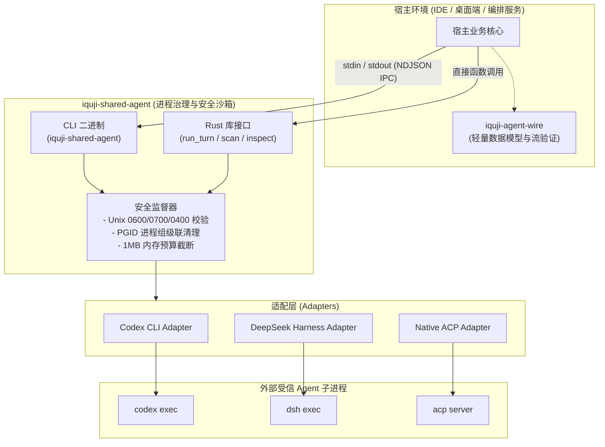
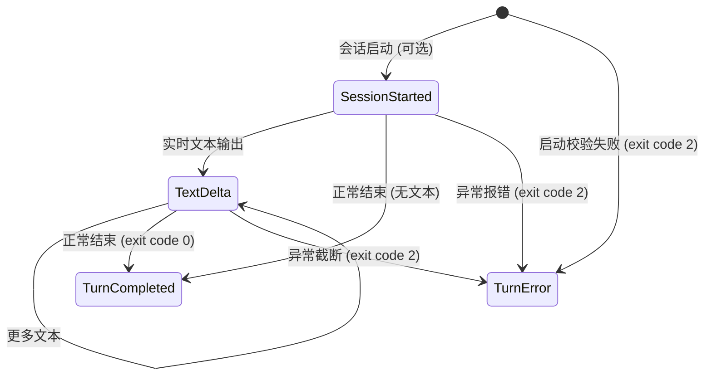

# iquji-agent

<div align="center">

[](https://crates.io/crates/iquji-shared-agent)
[](https://crates.io/crates/iquji-agent-wire)
[](https://github.com/haydardsx/iquji-community-agent/actions/workflows/ci.yml)
[](LICENSE)
[-orange.svg)](rust-toolchain.toml)
[](https://docs.rs/iquji-shared-agent)

**用于连接和监督本机已授权 AI Coding Agent 的零信任 Rust 连接网关与进程监督器**

[简体中文](README.md) | [English](README.en.md)

</div>

---

## 目录 (Table of Contents)

- [项目定位与解决的痛点](#项目定位与解决的痛点)
- [系统架构与产物总览](#系统架构与产物总览)
  - [系统架构图](#系统架构图)
  - [仓库核心产物与消费方式](#仓库核心产物与消费方式)
- [支持的 Agent 与能力矩阵](#支持的-agent-与能力矩阵)
- [安全与沙箱隔离架构](#安全与沙箱隔离架构)
- [快速上手 (Quick Start)](#快速上手-quick-start)
- [全面使用指南](#全面使用指南)
  - [1. 作为命令行工具 (CLI) 使用](#1-作为命令行工具-cli-使用)
  - [2. 作为 Rust 核心库 (iquji-shared-agent) 集成](#2-作为-rust-核心库-iquji-shared-agent-集成)
  - [3. 作为轻量数据契约 (iquji-agent-wire) 集成](#3-作为轻量数据契约-iquji-agent-wire-集成)
  - [4. DeepSeek 模型覆盖与补丁制品导出](#4-deepseek-模型覆盖与补丁制品导出)
  - [5. 图片多模态附件处理](#5-图片多模态附件处理)
- [配置规范参考 (Configuration Schema)](#配置规范参考-configuration-schema)
- [Wire 协议与 NDJSON 事件流规范](#wire-协议与-ndjson-事件流规范)
- [稳定错误码与诊断指南](#稳定错误码与诊断指南)
- [本地开发、测试与发布流程](#本地开发测试与发布流程)
- [开源协议与参与贡献](#开源协议与参与贡献)

---

## 项目定位与解决的痛点

在构建面向开发者的 AI 宿主系统（如 IDE 插件、桌面 Agent 应用、后台编排引擎等）时，直接通过 `std::process::Command` 启动开发者本地安装的第三方 CLI Agent（例如 OpenAI Codex CLI、DeepSeek Harness CLI 或各类 ACP Agent）面临诸多严峻的工程与安全挑战：

1. **孤儿进程与僵尸进程隐患**：当宿主遇到用户取消、超时或崩溃时，外部 Agent 的多层子进程容易脱离控制、常驻后台，持续耗尽 CPU/GPU 算力或锁定工作区。
2. **输出内存炸弹 (Output Bomb)**：恶意或异常的 Agent 进程可能在 stdout/stderr 突发输出海量日志，导致宿主内存耗尽 (OOM)。
3. **凭据安全与零信任边界**：直接暴露系统的环境变量或让工具猜测用户配置极易引发凭据泄漏或配置污染。
4. **异构协议适配成本高**：不同 Agent 的命令行参数、认证还原机制、会话续聊机制和流式返回格式各不相同。

**`iquji-agent` 针对上述挑战提供了标准化的开源解决方案：**
- **严苛的进程组监督**：通过 POSIX 进程组与 `--process-group-owner` 机制，确保取消、超时与异常时级联回收整个进程树。
- **有界计算与内存预算**：严格约束运行超时（默认 60s）、缓冲区上限（默认 1MB）、Prompt 字节数（最大 64KB）及 JSON 请求体上限（最大 400KB）。
- **零特权与强权限防御**：配置文件要求绝对权限 `0600`、父目录 `0700`，图片附件要求只读 `0400`，不越权读取敏感密钥。
- **统一的 NDJSON 机器流合同**：将异构 Agent 抹平为标准的 `session_started`、`text_delta`、`turn_completed` 与 `turn_error` 事件流。

---

## 系统架构与产物总览

### 系统架构图



### 仓库核心产物与消费方式

本项目是一个 Cargo Workspace，主要生成以下 **4 种不同形态的制品**：

| 产物名称 | 分发形态 | 适用受众 | 典型用法 |
| --- | --- | --- | --- |
| **`iquji-shared-agent` (CLI)** | 独立二进制命令 | Shell 脚本、Node.js / Python / Go 宿主进程 | 编译安装后通过 `iquji-shared-agent --config <path> turn` 执行 IPC 交互 |
| **`iquji-shared-agent` (Rust 库)** | Crates.io 核心库 | Rust 编写的原生宿主系统 | `cargo add iquji-shared-agent`，调用 `run_turn` 处理回合流式回调 |
| **`iquji-agent-wire` (协议库)** | Crates.io 轻量契约库 | 第三方客户端、SDK、测试 Harness | `cargo add iquji-agent-wire`，反序列化 NDJSON 流，无需引入进程执行器 |
| **DeepSeek 模型覆盖制品** | 私有目录文件 (`.patch`, `.yaml`) | 需要受控覆盖 DeepSeek 模型的运维或编排层 | 通过 `inspect --model <id> --output-directory <dir>` 导出的纯净补丁配置 |

---

## 支持的 Agent 与能力矩阵

| 接入对象 (Adapter) | 版本验证与元数据检查 | 会话续聊支持 | 文本流式事件 (`text_delta`) | 多模态图片 (PNG/JPEG) | 逐回合 HTTP MCP 注入 | 写入沙箱控制 |
| --- | :---: | :---: | :---: | :---: | :---: | :---: |
| **Codex CLI** | ✅ 真实参数与帮助核验 | ✅ 支持真实线程续聊 | ✅ 已完成 assistant 文本 | ✅ 支持 (暂存转换) | ✅ 官方支持 | ✅ `workspace-write` 沙箱 |
| **DeepSeek Harness** | ✅ `--dump-config` 校验 | ❌ 仅限单次文本回合 | ❌ 仅输出最终完成包 | ❌ 启动前明确拒绝 | ✅ 基于官方 `--patch` | ✅ headless 写入预设 |
| **Native ACP / 外部 Adapter** | ✅ `initialize` 握手核验 | ⚠️ 取决于对端 `loadSession` | ✅ 支持实时流式输出 | ✅ 支持 (Base64/MIME) | ⚠️ 需声明 HTTP 能力 | ❌ 强制只读沙箱 |
| **Claude CLI / Grok CLI** | ❌ 尚未实现 | ❌ 尚未实现 | ❌ 尚未实现 | ❌ 尚未实现 | ❌ 尚未实现 | ❌ 尚未实现 |

> [!NOTE]
> - 本工具对未实现或不支持的能力严格返回稳定错误（如 `model_unsupported`、`session_unsupported`），绝不伪造成功响应。
> - ACP 每次命令均建立全新连接，仅当对端在握手中声明了 `loadSession` 才能在后续调用中无缝恢复会话。

---

## 安全与沙箱隔离架构

本项目遵循严格的**纵深防御 (Defense-in-Depth)** 原则：

1. **严格的 Unix 文件权限约束**：
   - 配置文件：所有者必须为当前运行用户，文件权限必须为 `0600`。
   - 父目录：所有者必须为当前用户，权限须为 `0700`，严禁群组或其他用户具有写权限。
   - 图片附件：必须为当前用户持有的 `0400` 只读常规文件，且其直接父目录须为 `0700`。
   - 拒绝所有符号链接作为敏感配置或附件，防范通过软链接实施路径穿越与竞态攻击。
2. **外部进程组治理 (`--process-group-owner`)**：
   - 工具为每个外部 Agent CLI 创建并监管独立的 POSIX 进程组。
   - 当宿主进程本身具备根进程组时，可传递 `--process-group-owner <PID>` 继承该组，使得工具在退出或失败时准确清理自己持有的直接入口，宿主统一清理根组，彻底消灭孤儿进程。
3. **零凭据落盘与泄露防护**：
   - 不在日志、诊断信息或配置报告中输出 API Key、Token 等敏感值。
   - DeepSeek 从 `0.2.0` 起，仅在私有临时 `--patch` 中挂载 `@deepseek-ai/dsh-credentials-local` 等官方条目恢复认证，执行完毕即刻销毁，工具自身不解析其明文。
   - Codex 绝不读取用户本地的 `auth.json`。
4. **有界时间与空间配额**：
   - 单次回合默认限制 60 秒（配置范围：10ms ~ 10min）。
   - stdout 与 stderr 累计输出硬上限为 1 MiB（配置范围：128B ~ 4MiB）。
   - 单次 Prompt 限制在 64 KiB 以内，请求 JSON 限制在 400 KiB 以内。

---

## 快速上手 (Quick Start)

### 1. 前置依赖
- **操作系统**：macOS 或 Linux (Unix 环境)
- **Rust 工具链**：Rust `1.97.1` 或更高版本（Edition 2024）

### 2. 安装二进制工具与依赖

通过 crates.io 安装 CLI 二进制：
```sh
cargo install iquji-shared-agent --version 0.1.0 --locked
```

或在你的 Cargo 项目中添加库依赖：
```toml
[dependencies]
iquji-shared-agent = "0.1.0"
iquji-agent-wire = "0.1.0"
```

### 3. 初始化私有配置

创建受保护的配置目录并从示例模板初始化：
```sh
mkdir -p .local
chmod 700 .local
cp config.example.json .local/config.json
chmod 600 .local/config.json
```

修改 `.local/config.json` 中的 `executable` 为你本机已安装的 Codex 或 DeepSeek 实际绝对路径，例如：
```json
{
  "schemaVersion": 1,
  "workingDirectory": "/Users/yourname/workspace/my-project",
  "timeoutMs": 5000,
  "maxOutputBytes": 32768,
  "agents": [
    {
      "id": "local-codex",
      "adapter": "codex_cli",
      "executable": "/usr/local/bin/codex"
    }
  ]
}
```

### 4. 扫描并验证本地 Agent
```sh
iquji-shared-agent --config "$PWD/.local/config.json" scan local-codex
```
如果输出包含 `"status": "detected"`，说明该 Agent 已通过版本与参数核验。

### 5. 执行首次交互 (Turn)
```sh
printf '%s\n' '{"agentId":"local-codex","prompt":"请输出：Hello iquji!"}' | \
  iquji-shared-agent --config "$PWD/.local/config.json" turn
```

---

## 全面使用指南

### 1. 作为命令行工具 (CLI) 使用

CLI 提供了三大核心子命令：`scan`、`inspect` 与 `turn`。

#### A. 扫描可用性 (`scan`)
检查配置中登记的 Agent 是否在本地可执行并符合协议版本要求（不触发模型调用，不生成计费）：
```sh
# 扫描指定 Agent
iquji-shared-agent --config .local/config.json scan local-codex

# 扫描全部已配置 Agent
iquji-shared-agent --config .local/config.json scan
```
**输出示例：**
```json
{
  "schemaVersion": 1,
  "kind": "agent_connection_scan",
  "readiness": "not_checked",
  "connections": [
    {
      "id": "local-codex",
      "adapter": "codex_cli",
      "status": "detected",
      "version": "codex-cli 0.1.0",
      "sessionMode": "resumable",
      "supportedInputFormats": ["image/png", "image/jpeg"]
    }
  ]
}
```

#### B. 检查配置与模型元数据 (`inspect`)
安全检查 Agent 的配置目录，获取当前生效的 Provider、支持的模型标识和凭据环境变量名称（不输出明文密钥）：
```sh
iquji-shared-agent --config .local/config.json inspect local-codex
```

#### C. 执行回合对话 (`turn`)
`turn` 从标准输入接收单条完整的 JSON 格式 `TurnRequest`，并在 stdout 上以 NDJSON（换行分隔的 JSON）流式打印事件，直到终态：
```sh
printf '%s\n' '{
  "agentId": "local-codex",
  "prompt": "优化当前目录下的 main.rs",
  "workspaceWrite": false
}' | iquji-shared-agent --config .local/config.json turn
```

**stdout 流式输出样例：**
```json
{"kind":"session_started","sessionId":"sess_abc123","resumable":true}
{"kind":"text_delta","text":"我已经查看了 main.rs，"}
{"kind":"text_delta","text":"建议进行如下优化..."}
{"kind":"turn_completed","sessionId":"sess_abc123","resumable":true,"text":"我已经查看了 main.rs，建议进行如下优化...","stopReason":"stop"}
```

#### D. 宿主进程组治理参数 (`--process-group-owner`)
当宿主进程统一管理进程树时，在命令末尾追加参数：
```sh
iquji-shared-agent --config .local/config.json turn --process-group-owner 12345
```

---

### 2. 作为 Rust 核心库 (iquji-shared-agent) 集成

在 Rust 原生程序中，你可以直接引入 `iquji-shared-agent`，享受免序列化开销的高性能进程监督：

```rust
use iquji_shared_agent::{Configuration, TurnEvent, TurnRequest, run_turn};
use std::path::Path;
use std::sync::atomic::AtomicBool;

fn main() -> Result<(), Box<dyn std::error::Error>> {
    // 1. 加载受保护的配置文件
    let config = Configuration::load(Path::new(".local/config.json"))?;

    // 2. 构建类型安全的 TurnRequest
    let request = TurnRequest {
        agent_id: "local-codex".to_string(),
        prompt: "帮我编写一段快速排序算法".to_string(),
        workspace_write: false,
        session_id: None, // 续聊时传入之前的 sessionId
        model: None,
        context_fingerprint: None,
        attachments: Vec::new(),
        mcp_servers: Vec::new(),
    };

    // 3. 取消信号控制器
    let cancelled = AtomicBool::new(false);

    // 4. 执行回合，通过闭包消费实时事件
    let result = run_turn(&config, request, &cancelled, |event: TurnEvent| {
        match event {
            TurnEvent::SessionStarted { session_id, resumable } => {
                println!("[会话建立] ID: {session_id}, 可续聊: {resumable}");
            }
            TurnEvent::TextDelta { text } => {
                print!("{text}");
            }
        }
    })?;

    println!("\n[回合完成] StopReason: {}", result.stop_reason);
    Ok(())
}
```

---

### 3. 作为轻量数据契约 (iquji-agent-wire) 集成

如果你的系统是作为客户端、网关或 IPC 解析层，不需要执行实际进程，可直接依赖零冗余的 `iquji-agent-wire`：

```rust
use iquji_agent_wire::{
    TurnOutput, TurnRequest, decode_turn_output, decode_turn_request,
};

fn handle_incoming_ipc(raw_json: &[u8]) {
    // 验证并解码输入的请求 JSON
    if let Ok(request) = decode_turn_request(raw_json) {
        println!("收到合法请求 Agent: {}", request.agent_id);
    }

    // 验证并解析收到的 NDJSON 行
    let line = br#"{"kind":"text_delta","text":"正在思考..."}"#;
    if let Ok(output) = decode_turn_output(line) {
        match output {
            TurnOutput::Event(event) => println!("事件: {:?}", event),
            TurnOutput::Terminal(terminal) => println!("终态: {:?}", terminal),
        }
    }
}
```

---

### 4. DeepSeek 模型覆盖与补丁制品导出

针对使用 DeepSeek Harness 的场景，如果宿主应用需要自行审计和下发模型覆盖，可以使用 `inspect` 子命令导出加密校验的补丁制品：

```sh
iquji-shared-agent --config .local/config.json inspect local-deepseek \
  --model deepseek-reasoner \
  --output-directory "$PWD/my-safe-patch-dir"
```

- 该命令会在指定的高权限私有目录（`0700`）中生成临时 patch 和 settings 制品。
- 输出报告中包含生成制品的精确字节大小与 `SHA-256` 摘要，宿主可依据该摘要安全使用或独立分发。

---

### 5. 图片多模态附件处理

支持通过 `attachments` 字段向支持视觉能力的 Agent（如 Codex CLI、Native ACP）传输 PNG 或 JPEG 图片快照：

```json
{
  "agentId": "local-codex",
  "prompt": "分析截图中展示的编译错误原因",
  "attachments": [
    {
      "kind": "image",
      "path": "/absolute/safe/snapshot.png",
      "mediaType": "image/png",
      "size": 1048576,
      "sha256": "e3b0c44298fc1c149afbf4c8996fb92427ae41e4649b934ca495991b7852b855"
    }
  ]
}
```

> [!WARNING]
> - 图片文件权限必须为 `0400`（仅当前用户可读），所在目录权限必须为 `0700`。
> - 单个回合最多携带 3 张图片，单图最大 4 MiB，图片总和最大 12 MiB。
> - 工具会在执行前严格对比文件大小、魔数格式头与 SHA-256，拒绝任何不匹配或软链接。

---

## 配置规范参考 (Configuration Schema)

配置文件 `.local/config.json` 顶级字段说明：

| 字段名称 | 类型 | 必填 | 默认值 | 说明与约束 |
| --- | --- | :---: | --- | --- |
| `schemaVersion` | `u32` | 是 | `1` | 配置架构版本，当前固定为 `1` |
| `workingDirectory` | `String` | 是 | - | 规范化的绝对路径，作为外部 Agent 的执行上下文根目录 |
| `agents` | `Array<Agent>` | 是 | - | 登记的 Agent 列表（最多支持 16 个） |
| `timeoutMs` | `u64` | 否 | `1000` | 探测与元数据检查超时时间（毫秒） |
| `maxOutputBytes` | `usize` | 否 | `16384` | 探测过程 stdout/stderr 最大允许输出字节 |
| `turnTimeoutMs` | `u64` | 否 | `60000` | 单次 Turn 执行硬上限（毫秒，10ms ~ 10min） |
| `maxTurnOutputBytes` | `usize` | 否 | `1048576` | 单次 Turn 累计最大允许输出字节（128B ~ 4MiB） |

单个 `Agent` 对象字段说明：

| 字段名称 | 类型 | 必填 | 说明 |
| --- | --- | :---: | --- |
| `id` | `String` | 是 | 唯一英文数字标识符（支持 `a-z`, `0-9`, `-`, `_`） |
| `adapter` | `String` | 是 | 适配器类型：`codex_cli`, `deepseek_harness`, `native_acp`, `external_acp_adapter` |
| `executable` | `String` | 是 | 可执行文件的绝对路径（可为符号链接，但最终目标须为正规可执行文件） |
| `expectedSha256` | `String` | 否 | 可选。可执行文件目标的 64 位小写 SHA-256，用于完整性防篡改核验 |
| `codexConfigurationDirectory` | `String` | 否 | 仅 Codex：显式指定的配置目录绝对路径 |
| `deepseekConfigurationDirectory`| `String` | 否 | 仅 DeepSeek：显式指定的 DSH 配置目录绝对路径 |
| `environmentVariables` | `Array<String>` | 否 | 白名单透传的环境变量**名称**列表（不保存敏感值） |

---

## Wire 协议与 NDJSON 事件流规范

回合的输出流由单行 JSON 组成（NDJSON），消费者必须同时校验退出码与完整终态：



1. **`session_started` (事件)**：
   `{"kind":"session_started", "sessionId":"...", "resumable":true}`
2. **`text_delta` (事件)**：
   `{"kind":"text_delta", "text":"..."}`
3. **`turn_completed` (成功终态)**：
   `{"kind":"turn_completed", "sessionId":"...", "resumable":true, "text":"...", "stopReason":"stop"}`
4. **`turn_error` (失败终态)**：
   `{"kind":"turn_error", "error":"turn_timed_out"}`

---

## 稳定错误码与诊断指南

命令执行失败时，CLI 会在 stderr 打印稳定的诊断错误码，并以退出码 `2` 终止（成功时为 `0`）。

| 错误代码 (`code`) | 产生原因 | 应对措施 |
| --- | --- | --- |
| `configuration_invalid` | 配置 JSON 格式错误或缺失必要字段 | 检查配置文件是否符合 Schema 规范 |
| `configuration_not_private` | 配置文件或目录权限过大 | 执行 `chmod 700 <目录>` 与 `chmod 600 <文件>` |
| `executable_unavailable` | 可执行文件路径不存在 | 检查 `executable` 路径是否正确 |
| `executable_digest_mismatch`| 可执行文件哈希与 `expectedSha256` 不匹配 | 更新配置中的预期 SHA-256 或核查二进制文件 |
| `turn_timed_out` | 回合执行耗时超过配置上限 | 适当调大 `turnTimeoutMs` 或排查 Agent 卡顿原因 |
| `turn_output_limit` | 输出内容字节数超出安全预算上限 | 调整 `maxTurnOutputBytes` 或减少输出提示 |
| `session_unsupported` | 尝试在不支持续聊的 Agent 上恢复会话 | DeepSeek 不支持续聊，去除 `sessionId` 重新调用 |
| `attachment_invalid` | 图片格式错误、非 PNG/JPEG 或权限非 0400 | 核查图片格式及所在目录与文件的严格权限 |

---

## 本地开发、测试与发布流程

### 本地编译与检查
本项目采用 Rust `1.97.1` (Edition 2024)：

```sh
# 1. 检出与构建
cargo build --locked

# 2. 预热 fixture 依赖
cargo fetch --locked --manifest-path protocol/tests/fixtures/host/Cargo.toml

# 3. 运行工作区完整测试套件
cargo test --workspace --locked

# 4. 代码规范检查
cargo clippy --locked --all-targets -- -D warnings
cargo fmt --check
```

> [!TIP]
> 仓库自带了完整的虚拟假 CLI、ACP 模拟进程及无副作用的测试 fixture。**测试过程完全离线运行**，不需要本机预先安装真实 Agent，不读取您的系统配置，也不触发真实模型付费调用。

### 自动化发布机制 (Auto Release)
- 合并至 `main` 分支会自动触发 `.github/workflows/auto-release.yml`。
- 发布规划器自动计算语义化版本号并创建带签名的不可变 Git Tag（格式为 `vX.Y.Z`）。
- 触发 `release.yml` 通过 GitHub OIDC 信任发布机制，按 `iquji-agent-wire` -> `iquji-shared-agent` 的依赖顺序安全推送到 crates.io，并在 GitHub 自动创建 Release。

---

## 开源协议与参与贡献

- **代码许可**：本项目基于 [MIT License](LICENSE) 许可协议开源。
- **参与贡献**：欢迎提交 Issue 与 Pull Request！提交前请务必阅读 [贡献指南 (CONTRIBUTING.md)](CONTRIBUTING.md) 与 [作者列表 (AUTHORS.md)](AUTHORS.md)。
